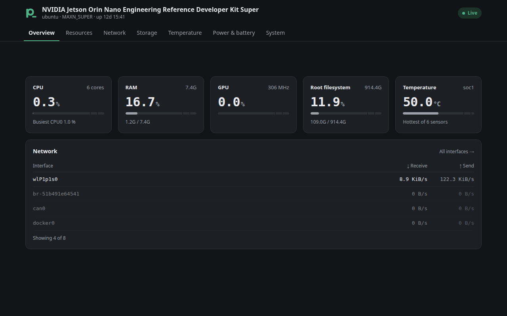
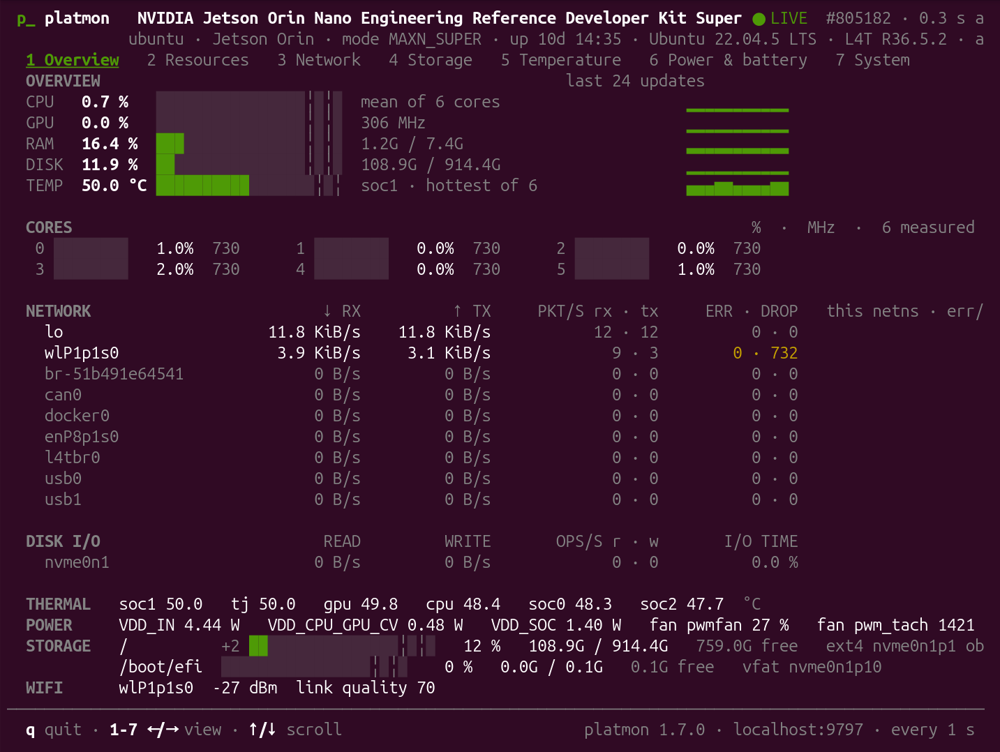
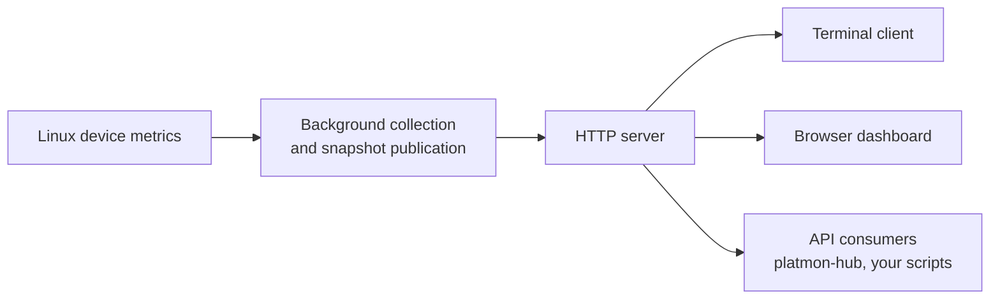

# platmon

<picture>
  <source media="(prefers-color-scheme: dark)" srcset="frontends/web/assets/brand/platmon-logo-dark.svg">
  
</picture>

**A 1.5 MB monitor for Jetson, Raspberry Pi and other Linux boards.** One background service reads the
device once a second and serves the same snapshot to a terminal client, a web dashboard and an HTTP API.

| Web dashboard | Terminal client |
| --- | --- |
|  |  |

- **Small enough to leave running.** One static binary of about 1.5 MB. On a Jetson Orin Nano over 24 h:
  0.80 to 0.89 % of one core and 10.6 to 11.4 MiB of memory at 1.8.1, while a Hub-like client polled it
  ([release evidence](docs/releases/readiness.md), [budget](docs/performance/budget.md)).
- **Nothing to install beside it.** The server depends on nothing on the device; the `platmon` command
  needs only Python 3.9+ and its standard library. No pip, no Node, no database.
- **Reads the board, not just the CPU.** CPU, GPU/NPU, memory and pressure (PSI), network, disk I/O,
  storage, temperatures, power rails, fans, power mode, battery, Wi-Fi signal and TCP connect probes.
- **Says what it does not know.** A reading the device does not have is `unavailable` with a reason, never
  a zero; every answer carries its age, and stale data is refused rather than shown as current.
- **One collection, any number of readers.** Requests never trigger a device read, so opening five
  dashboards costs the device no more collections than opening none.

> [!WARNING]
> The service has **no authentication** and listens on all IPv4 interfaces (`0.0.0.0:9797`) by default.
> Anyone who can reach the port can read the host name, kernel, interfaces and the other readings. Use it
> on trusted networks, or [restrict it](docs/guides/deployment.md#choosing-what-is-served). See the
> [security policy](SECURITY.md).

## Install

On Ubuntu or a Debian-derived system with systemd (amd64, arm64, armhf), from the signed APT repository:

```sh
sudo install -d -m 0755 /etc/apt/keyrings
curl -fsSL https://platmon.github.io/apt/platmon-archive-keyring.gpg \
  | sudo tee /etc/apt/keyrings/platmon.gpg > /dev/null
gpg --show-keys /etc/apt/keyrings/platmon.gpg   # 6D42 C14A BFB9 412F 34BA 4BEF F38B 9BB5 26A3 B0C6
sudo tee /etc/apt/sources.list.d/platmon.sources > /dev/null <<EOT
Types: deb
URIs: https://platmon.github.io/apt
Suites: stable
Components: main
Architectures: $(dpkg --print-architecture)
Signed-By: /etc/apt/keyrings/platmon.gpg
EOT
sudo apt update && sudo apt install platmon
```

The service starts with the install. Other ways in, all running the same server:

| You have | Use |
| --- | --- |
| No APT repository access | the `.deb` files and `SHA256SUMS` from [GitHub Releases](https://github.com/platmon/platmon/releases) ([steps](docs/guides/getting-started.md#requirements-and-installation)) |
| Fedora or Enterprise Linux 9+ | the `.rpm` packages ([RPM packages](docs/reference/packaging.md#rpm-packages)) |
| Another Linux, or a change to try | a [source installation or a locally built container](docs/guides/deployment.md) |
| A headless device without Python | `sudo apt install --no-install-recommends platmon`, then the web page or the API |
| A PC that only watches other devices | the terminal client alone: `scripts/install-cli.sh --user` from a checkout |

## Use

```sh
platmon                        # live terminal view of this device; 1-7 switch views, q quits
platmon 192.168.55.53          # another device
platmon --once                 # one plain snapshot, for scripts and logs
curl -s localhost:9797/text    # the same screen without the client
curl -s localhost:9797/api/stats
```

Open `http://<device>:9797` for the dashboard. Settings are in `/etc/platmon/platmon.ini`, where every
key is listed with its default; restart the service after an edit (`sudo systemctl restart platmon`).

To watch several devices in one place, run [platmon-hub](https://github.com/platmon/platmon-hub) on
another computer: it reads each device's API and adds history, alerts and exports. Which Hub release
reads which platmon release: [platmon-hub compatibility](docs/reference/hub-compatibility.md).



## Where it has run

| Device | System | Checked |
| --- | --- | --- |
| Jetson Orin Nano devkit | L4T R36.5.2, Ubuntu 22.04 | 1.4.0 to 1.8.1: the release binary checked on the device at each release; a soak of 24 h at 1.4.0, 1.7.0 and 1.8.1 (1.8.1's after its release), 1 h at 1.5.0 and 1.6.0, none at 1.8.0; GPU, power rails, fans, power mode |
| Raspberry Pi 4 Model B | Debian 13 | package install and upgrade (1.3.0), CPU and memory comparison (1.4.0) |
| x86-64 PC | Ubuntu 24.04 | development baseline |
| amd64 and arm64 containers | Ubuntu 22.04, 24.04, 26.04 | every commit: package lifecycle and the service under systemd |
| armhf | Debian 13, Ubuntu 24.04 under QEMU | package lifecycle only; **not yet on a real 32-bit board** |
| Windows 11 laptop | experimental zip, from 1.8.0 | the real-PC checks (2026-11-01); not supported |

Not on the list does not mean not working: unknown hardware gets the generic `/proc` and `/sys` readers.
If you run platmon on another board, a
[hardware report](https://github.com/platmon/platmon/issues/new?template=hardware_report.yml) is the most
useful thing you can send.

## How it compares

platmon is for the device itself: something light enough to ship on every board, with a screen and an API
built in. It is not a metrics platform.

| | platmon | jetson-stats (jtop) | Glances | Beszel | node_exporter |
| --- | --- | --- | --- | --- | --- |
| Shape | service + terminal + web + API | terminal + Python library | terminal + web + API | hub + agents | metrics endpoint |
| Runs as | one static binary | Python | Python | Go binaries | Go binary |
| Boards | Jetson, Raspberry Pi, any Linux | Jetson only | any | any | any |
| Board power, fans, power mode | read | read and control | partly | partly | partly |
| Long-term history, alerts | in platmon-hub | no | through exports | yes | through Prometheus |
| License | Apache-2.0 | AGPL-3.0 | LGPL-3.0 | MIT | Apache-2.0 |

Pick something else when you need to **control** a Jetson (jtop), per-container statistics or accounts and
alerts out of the box (Beszel), or you already run Prometheus and Grafana (node_exporter).

## Compatibility

From 1.0.0 the HTTP API's paths and fields, the `platmon.ini` keys and defaults, and the command options
change only compatibly within a major version ([versioning](docs/reference/packaging.md)). Each API
answer carries its own `schema_version`. History and replay are held in memory and cleared on restart;
long-term storage belongs to the consumer.

## Documentation

- **[Getting started](docs/guides/getting-started.md):** installation, configuration and first connections.
- **[CLI and web interfaces](docs/guides/interfaces.md):** views, controls, thresholds and available metrics.
- **[Deployment and operations](docs/guides/deployment.md):** systemd, Docker, networking and troubleshooting.
- **[HTTP API reference](docs/reference/api.md):** endpoints, payloads, freshness and related metric contracts.
- **[Documentation index](docs/README.md):** architecture, packaging, release readiness and performance evidence.

## Contributing

Reports from real devices, bug reports and pull requests are welcome: see [CONTRIBUTING.md](CONTRIBUTING.md).
Report vulnerabilities privately: see [SECURITY.md](SECURITY.md).

```sh
native/build.sh                                    # the server and its unit tests, in a container
python3 -m pip install -r tests/requirements.txt   # tests only; the runtime stays dependency-free
pytest
```

## License

[Apache-2.0](LICENSE) · [Brand assets and colors](frontends/web/assets/brand/README.md)
