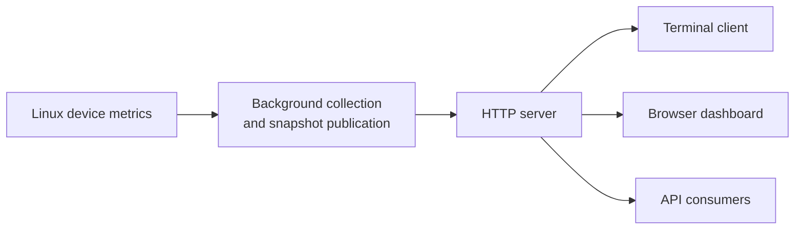

# platmon

<picture>
  <source media="(prefers-color-scheme: dark)" srcset="frontends/web/assets/brand/platmon-logo-dark.svg">
  
</picture>

> **TL;DR**
> - One background service collects Linux host metrics (CPU, GPU/NPU, memory, network, disk, sensors,
>   battery, Wi-Fi, pressure) and serves them to a terminal client, a web dashboard and an HTTP API on
>   port 9797.
> - Install the `.deb` (amd64, arm64, armhf) from the APT repository or GitHub Releases; it runs one
>   static native server.
> - No authentication: use it on trusted networks or restrict `[http] bind`.

Lightweight platform monitoring for Jetson, Raspberry Pi, PCs and other Linux hosts.
A background service collects device metrics once and serves them to a terminal client,
a browser dashboard and an HTTP API.



## Highlights

- **Dependency-free runtime:** the Debian package's server is one static native binary (amd64, arm64, armhf);
  the source installation and the container build and run the same server. The `platmon` command uses
  the Python 3.9+ standard library only. No Python packages to install on the device.
- **Hardware-aware monitoring:** CPU, available GPU/NPU, memory, network and disk I/O, storage,
  temperatures, power, fans, battery, Wi-Fi and pressure. Unsupported sources remain unavailable.
- **One collector, multiple views:** live terminal and web interfaces read the same published snapshots.
- **History and integration:** recent in-memory trends plus
  [bounded full-sample replay](docs/reference/replay.md) for external consumers.
- **Deployment choices:** Debian package with systemd, source installation or a locally built Docker image,
  all running the native server.

## Quick start

On Ubuntu/Debian-derived Linux (amd64, arm64 or armhf) with systemd (and Python 3.9+ for the `platmon`
command, package `platmon-cli`), install from the signed
[APT repository](https://platmon.github.io/apt/) (see [getting started](docs/guides/getting-started.md)),
download a verified package from [GitHub Releases](https://github.com/platmon/platmon/releases),
or build one from this checkout (Linux with `dpkg-deb` and Docker for the server's build required):

```sh
native/build.sh
platmon_version=$(python3 scripts/packaging/package.py --version)
platmon_arch=$(dpkg --print-architecture)
platmon_dist="dist/${platmon_version}-1"
python3 scripts/packaging/package.py --output "$platmon_dist"
python3 scripts/packaging/check_package.py "$platmon_dist/platmon_${platmon_version}-1_${platmon_arch}.deb"
sudo apt install "./${platmon_dist}/platmon_${platmon_version}-1_${platmon_arch}.deb" \
  "./${platmon_dist}/platmon-cli_${platmon_version}-1_all.deb"
```

```sh
platmon --once           # one snapshot
platmon                  # interactive terminal view
curl -s localhost:9797/api/status
```

Open `http://<device>:9797` in a browser to view the dashboard.
The service is unauthenticated and listens on all IPv4 interfaces by default:
**use it only on trusted networks**, or restrict the bind address in `platmon.ini`.

## Documentation

- **[Getting started](docs/guides/getting-started.md):** installation, configuration and first connections.
- **[CLI and web interfaces](docs/guides/interfaces.md):** views, controls, thresholds and available metrics.
- **[Deployment and operations](docs/guides/deployment.md):** systemd, Docker, networking and troubleshooting.
- **[HTTP API reference](docs/reference/api.md):** endpoints, payloads, freshness and related metric contracts.
- **[Documentation index](docs/README.md):** architecture, packaging, release readiness and performance evidence.

## Development

```sh
python3 -m pip install -r tests/requirements.txt  # tests only; runtime stays dependency-free
pytest
```

See the [architecture guide](docs/development/architecture.md) for source layout and module boundaries,
and [performance reports](docs/performance/README.md) for measured overhead and its limits.

## License

[Apache-2.0](LICENSE) · [Brand assets and colors](frontends/web/assets/brand/README.md)
