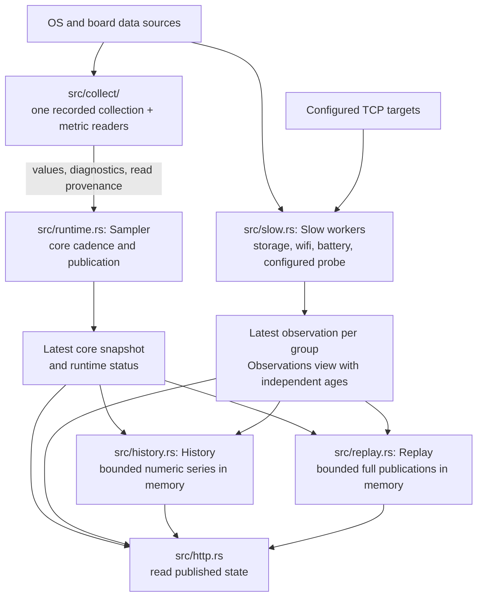
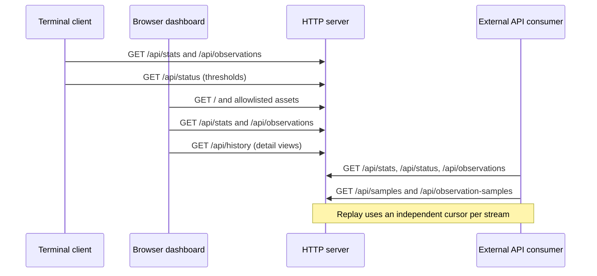

# Architecture

> **TL;DR**
> - One collector publishes snapshots; HTTP, the terminal client and the web page only read them, and slow
>   groups run on their own threads.
> - The server is the native one (`native/`, one Rust crate). The Python server it was ported from was
>   removed after 1.6.0; its recorded answers (`native/tools/equivalence/golden/`) stay the reference.
> - Layers: collectors read the system, the runtime schedules and publishes, frontends present.

The service reads system data once and publishes snapshots for the HTTP API, terminal client and web
viewer. Runtime scheduling is independent of frontend requests.

The Debian package, the source installation and the container run the server built from `native/`.
It was ported module by module from a Python server (`platmon.py`, `collector/`, `runtime/`), deprecated in
1.5.0 and removed after 1.6.0; the HTTP API, `platmon.ini` and its messages, and `/text` are its contracts,
and the Python answers recorded before the removal are what the equivalence checks compare with
([native/README.md](../../native/README.md)). Comments in `native/src/` describe the Rust code; where they name
Python, they mean its language or standard library (the recorded answers fix that behavior), the Python service
as the port's origin and the recorded answers' source, or, in the ported tests, the Python test and the functions
it called ([Python test port](python-test-port.md)). The Python modules are in the git history up to 1.6.0. `src/main.rs` loads and validates the
configuration, constructs the readers and workers, and starts the HTTP frontend.

## Collection and runtime

Arrows below follow data from readers to published state. `serve` wires the core sampler and each enabled
slow group to their own cadence; Probe gets a worker only when targets are configured.

History and replay receive records at publication time and are independently optional; neither
triggers collection or persists across a service restart. HTTP reads do not initiate device reads.
Failed or overlong core attempts do not publish a new snapshot; live stats become unavailable once
the last good snapshot is stale.
Slow groups retain their own observation state and age, so a blocked group does not stall the core.
See the [live API](../reference/api.md), [observations](../reference/observations.md),
[numeric history](../reference/history.md) and [full-sample replay](../reference/replay.md) contracts.

`native/` is one Rust crate, depending only on `libc` (and `windows-sys` on Windows).

| Location | Responsibility |
| --- | --- |
| `src/main.rs` | Command dispatch (`serve`, `health`, `service` on Windows, `config-check`, `build-info`, the tool commands) |
| `src/config.rs` | `platmon.ini` parsing and checks, its defaults, messages and levels |
| `src/collect/linux/`, `src/collect/windows/` | One collector per OS; `collect/mod.rs` holds the CPU counters and required-read spans both use, `collect/probe.rs` the shared probe |
| `src/collect/linux/common.rs`, `jetson.rs`, `accel.rs`, `nvidia.rs` | Generic Linux readings, board-specific extensions, DRM and accel devices, nvidia-smi |
| `src/collect/linux/passive.rs`, `observe.rs` | Network, disk I/O and pressure; the slow groups' readers (storage, Wi-Fi, battery) |
| `src/collect/linux/sysfs.rs` | Filesystem access, device discovery and path identity resolution |
| `src/metadata.rs`, `src/sha256.rs` | Group diagnostics, read spans, sensor source ids and pointers |
| `src/runtime.rs` | Sampler: cadence, publication, freshness and status |
| `src/slow.rs` | Low-frequency groups on their own threads |
| `src/history.rs`, `src/replay.rs` | Bounded in-memory history and full-publication replay |
| `src/http.rs`, `src/render.rs` | HTTP API, `/text` (the terminal client's plain screen) and the web page's files; reads published state only |
| `src/json.rs`, `src/pystr.rs` | JSON written as Python's `json` wrote it; the `str` methods the ports need |
| `src/platform/` | Clocks, random bytes, the listening socket and the stop request, per OS |
| `src/harness.rs`, `tools/` | Commands and scripts for the equivalence checks, measurements and candidate deployments |

Equivalence checks run in CI (`native` job); the Windows collector is checked by its unit tests and
`tools/windows_smoke.py`. Build, support scope and results: [native/README.md](../../native/README.md).

## Layers

Collection (`src/collect/`) ← runtime (`src/runtime.rs`, `slow.rs`, `history.rs`, `replay.rs`) ← HTTP
(`src/http.rs`) ← `frontends/` (clients of that API). Readers do not depend on the runtime; the runtime
consumes collection records and metadata; the HTTP server consumes published snapshots, observations and
history. `/text` is `src/render.rs`, a port of `frontends/cli.py`'s `render`, so the two stay identical
(`native/tools/equivalence/live_http.py` checks the sections). The web page is a client too, although the
server serves its files.

## Frontends

`src/http.rs` serves the API, `/text`, the HTML page and an explicit allowlist of web assets.
`frontends/web/index.html` owns markup and server-injected version/threshold values; `styles.css` owns
styling and `app.js` owns polling, navigation and rendering. No JavaScript build step is required.

`frontends/cli.py` remains one standard-library Python file so `scripts/install-cli.sh` can install it
on a client machine without the server; it imports nothing from the project. The server's `/text` is a
port of its plain renderer. The CLI keeps a copy of `VERSION`, checked by `tests/frontends/test_cli.py`.

Clients request these routes from the same HTTP server. The requests below illustrate each client's
role; clients poll independently, and the displayed order is not a shared schedule.

The CLI keeps its own short sparkline history from polled stats; browser detail views request
`/api/history`. Neither built-in viewer uses replay. Web assets require `[http] web = yes`, while
the API and `/text` also work with `web = no`. Replay consumers manage their own per-stream cursors
and durable storage outside this service.

## Deployment and distribution

`deploy/systemd/` groups the source installation's scripts; the unit they write is the package's
(`packaging/debian/platmon.service`) with the installed paths.
`deploy/docker/` groups container configuration and scripts. Run these scripts from any working
directory; direct Compose commands in the README run from the checkout root. Compose resolves its
build context and default INI file back to that root.

`packaging/debian/` contains package metadata, the package's unit and lifecycle hooks. `scripts/packaging/`
contains the builder, extracted-package smoke check and disposable-container lifecycle and systemd service
checks. The Debian package contains the static server built from `native/` (`native/build.sh`, one package
per architecture), the web files of `frontends/web/` and the `platmon` command (`frontends/cli.py`). The
source installation and the container install the same server and web files; `native/tools/` compares the
server with the Python server's recorded answers. The source archive additionally includes `native/`,
deployment files, build tools, tests and documentation.

Installed paths are `/usr/lib/platmon/platmon-native` for the Debian server and `/usr/share/platmon` for its
web files, `/opt/platmon` for the source installation's and the container's server and web files, `/etc/platmon/platmon.ini` for service configuration and
`platmon.service` for the systemd unit.

## Tests and documentation

The server's tests are Rust unit tests in `native/src/` (`native/build.sh` runs them); the equivalence checks
are in `native/tools/`. `pytest` runs the Python and web tests from the root: `tests/frontends/` (the
terminal client, the web page's harnesses and browser scripts) and `tests/packaging/` (the builder,
installers and scripts).

User-facing installation and operation guides live in `docs/guides/`, behavior contracts
in `docs/reference/`, development plans and checkpoints in `docs/development/`,
release decisions in `docs/releases/`, and measurement reports in `docs/performance/`. Each performance
report keeps the commit it measured; superseded reports are in the git history.
