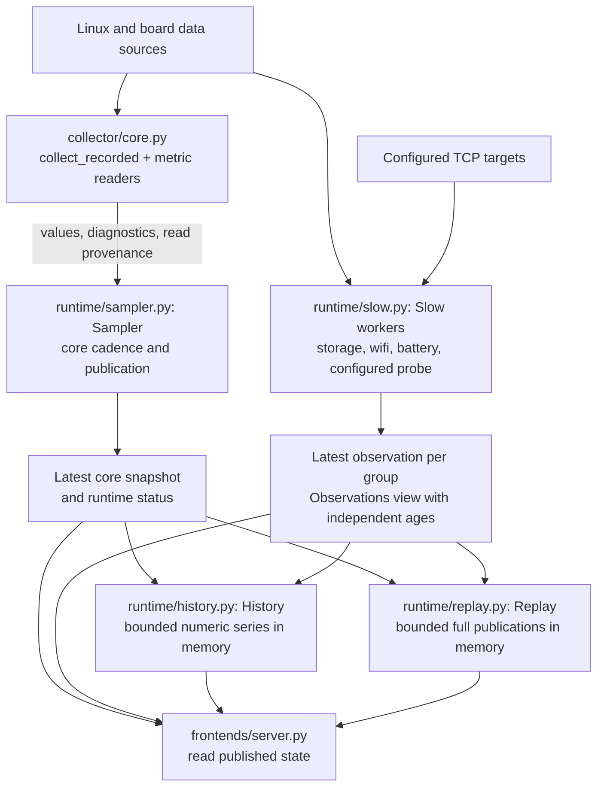
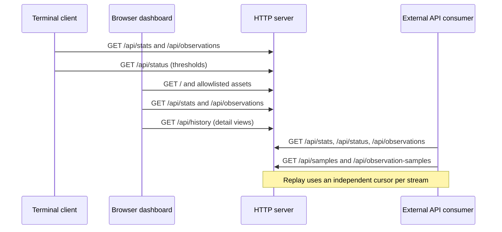

# Architecture

The service reads system data once and publishes snapshots for the HTTP API, terminal client and web
viewer. `platmon.py` loads and validates configuration, constructs the readers and workers, and starts
the HTTP frontend. Runtime scheduling is independent of frontend requests.

## Collection and runtime

Arrows below follow data from readers to published state. `platmon.py` wires the core sampler and
each enabled slow group to their own cadence; Probe gets a worker only when targets are configured.

History and replay receive records at publication time and are independently optional; neither
triggers collection or persists across a service restart. HTTP reads do not initiate device reads.
Failed or overlong core attempts do not publish a new snapshot; live stats become unavailable once
the last good snapshot is stale.
Slow groups retain their own observation state and age, so a blocked group does not stall the core.
See the [live API](../reference/api.md), [observations](../reference/observations.md),
[numeric history](../reference/history.md) and [full-sample replay](../reference/replay.md) contracts.

| Location | Responsibility |
| --- | --- |
| `collector/core.py` | Platform detection and assembly of one collection; `collector/__init__.py` exposes the collection entrypoints |
| `collector/common.py`, `jetson.py` | Generic Linux readings and board-specific extensions |
| `collector/network.py`, `disk_io.py`, `pressure.py`, `gpu.py`, `npu.py` | Metric readers used by the core sampler |
| `collector/storage.py`, `wifi.py`, `battery.py`, `probe.py` | Readers run as low-frequency observations |
| `collector/sysfs.py` | Filesystem access, device discovery and path identity resolution |
| `collector/metadata.py` | Collection diagnostics, read timing, sensor source descriptors and JSON pointers |
| `collector/record.py` | Recorded collection values and spans shared between readers and the sampler |
| `collector/counters.py` | File reading and unsigned counter parsing shared by passive readers |
| `runtime/sampler.py` | Cadence, snapshot publication, freshness and runtime status |
| `runtime/slow.py` | Independent workers and published low-frequency observations |
| `runtime/replay.py` | Bounded full-publication buffer for cursor-based Hub catch-up |
| `runtime/history.py` | Bounded, in-memory history of published snapshots and observations |

Readers do not import the runtime or frontends. Runtime modules consume collection records and
metadata; the HTTP server consumes published snapshots, observations and history. Filesystem helpers
attach discovery diagnostics through metadata groups; `hwmon_chips()` imports `Group` locally to keep
module initialization acyclic.

## Frontends

`frontends/server.py` serves the API, `/text`, the HTML page and an explicit allowlist of web assets.
`frontends/web/index.html` owns markup and server-injected version/threshold values; `styles.css` owns
styling and `app.js` owns polling, navigation and rendering. No JavaScript build step is required.

`frontends/cli.py` remains one standard-library Python file so `scripts/install-cli.sh` can install it
on a client machine without the collector or runtime. The HTTP server also uses its plain renderer for
`/text`, and the package builder reads its version constant without importing device readers.

Clients request these routes from the same HTTP server. The requests below illustrate each client's
role; clients poll independently, and the displayed order is not a shared schedule.

The CLI keeps its own short sparkline history from polled stats; browser detail views request
`/api/history`. Neither built-in viewer uses replay. Web assets require `[http] web = yes`, while
the API and `/text` also work with `web = no`. Replay consumers manage their own per-stream cursors
and durable storage outside this service.

## Deployment and distribution

`deploy/systemd/` groups the source service unit with its installation and start/stop scripts.
`deploy/docker/` groups container configuration and scripts. Run these scripts from any working
directory; direct Compose commands in the README run from the checkout root. Compose resolves its
build context and default INI file back to that root.

`packaging/debian/` contains package metadata, the package's unit and lifecycle hooks. `scripts/packaging/`
contains the builder, extracted-package smoke check and disposable-container lifecycle and systemd service
checks. The Debian package contains the static server built from `native/` (`native/build.sh`, one package
per architecture), the web files of `frontends/web/` and the `platmon` command (`frontends/cli.py`). The
Python server (`platmon.py`, `collector/`, `runtime/`, `frontends/`) runs the source installation and the
container; `native/tools/` compares the two. The source archive additionally includes `native/`, deployment
files, build tools, benchmarks, tests and documentation.

Installed paths are `/usr/lib/platmon/platmon-native` for the Debian server and `/usr/share/platmon` for its
web files, `/opt/platmon` for source/container code, `/etc/platmon/platmon.ini` for service configuration and
`platmon.service` for the systemd unit.

## Tests and documentation

Tests mirror the responsible source areas in `tests/collector/`, `tests/runtime/`, `tests/frontends/`,
`tests/packaging/` and `tests/benchmarks/`. Shared test helpers use explicit package imports. Web harness
and browser scripts live with frontend tests. `pytest` still runs the entire suite from the root.

User-facing installation and operation guides live in `docs/guides/`, behavior contracts
in `docs/reference/`, development plans and checkpoints in `docs/development/`,
release decisions in `docs/releases/`, and measurement reports in `docs/performance/`. Superseded performance reports are retained in `docs/performance/archive/`;
their measured commits and results remain historical evidence.
