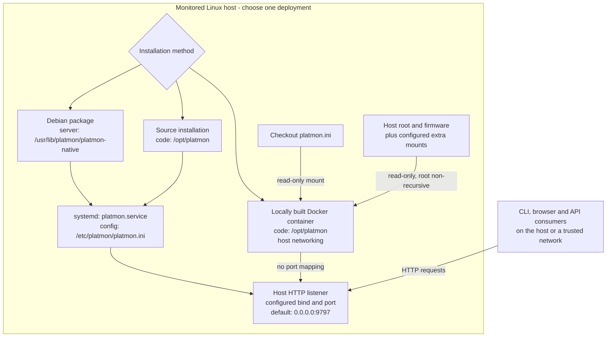

# Deployment and operations

> **TL;DR**
> - Pick one deployment: the Debian package (recommended), a source install under systemd, or a locally
>   built Docker image; all listen on port 9797.
> - The source install and the container run the deprecated Python server.
> - Expose the unauthenticated API only to trusted networks. The repository ships a Dockerfile, not an
>   image: publishing a built image distributes its GPL/LGPL base userland.

platmon runs one collector service on the monitored device. Choose
**one** of these deployment methods: a Debian package, source systemd
installation, or Docker. The systemd and Docker startup scripts refuse
a conflicting running or boot-enabled instance; both normally use
TCP port 9797.



The alternatives converge on one running service, not multiple collectors. For Docker, the host
network namespace and configured filesystem mounts determine what is visible; host networking
alone does not expose every host filesystem. See [Docker observation scope](../reference/docker-scope.md).

## Debian package

For Ubuntu/Debian-derived Linux, the `.deb` is the primary distribution.
Install it from the signed APT repository, or a checksum-verified package
file with APT, then use `systemctl` and `platmon` to operate it. The package installs the service as
`platmon.service` (the static native server, `/usr/lib/platmon/platmon-native`), web files under
`/usr/share/platmon` and configuration at `/etc/platmon/platmon.ini`. The source installation and
the container run the Python server below.

APT preserves edited configuration across updates. Existing source or
Docker installs require an explicit migration, not an in-place switch.
Follow [getting started](getting-started.md#requirements-and-installation)
and the authoritative
[packaging, migration and rollback procedures](../reference/packaging.md).

## Source installation with systemd

This runs the Python server, which is deprecated and will be removed in a later release
([changelog](../../CHANGELOG.md)); the Debian package runs the native server.

From a checkout, on a Linux device with systemd and Python 3.9+:

```sh
deploy/systemd/install.sh              # install/update, enable at boot, start, add CLI
deploy/systemd/start.sh                # start or restart; readiness check via /api/stats
deploy/systemd/stop.sh                 # stop now; still enabled for the next boot
deploy/systemd/uninstall.sh            # disable and remove code, unit and CLI; keep config
deploy/systemd/uninstall.sh --purge    # also remove /etc/platmon config
```

The installer validates the candidate config before changing the service.
It stages a complete copy, then replaces `/opt/platmon` and adapts the
unit in `/etc/systemd/system/`. A failed replacement or readiness check
attempts to restore the previous code and unit. A successful update retains
the previous files in a printed recovery directory. For limitations and
manual recovery, use [rollback](../reference/packaging.md#rollback).

The installer creates `/etc/platmon/platmon.ini` only when it does not
already exist, preserving user edits. Inspect logs with
`journalctl -u platmon`. An older source config may still use the
pre-9797 default port 8080; check its `[http] port`, or explicitly change
it if desired. `start.sh` prints the effective port.

Do not use these scripts to overwrite a package-managed installation:
use APT for packages.

## Docker on native Linux

This runs the Python server, which is deprecated and will be removed in a later release
([changelog](../../CHANGELOG.md)); the Debian package runs the native server.

No ready-made image is published. Build locally from the repository
(see [Container image licensing](#container-image-licensing)):

```sh
deploy/docker/start.sh    # build/start; detect Jetson override; wait for health check
deploy/docker/stop.sh     # stop/remove the container; keep the local image
```

`start.sh` builds `platmon:local` and also installs/updates the
`platmon` terminal client in `~/.local/bin`; `stop.sh` leaves the
client installed. To remove it explicitly, run
`scripts/install-cli.sh --user --uninstall`.

The base Compose file is `deploy/docker/compose.yaml`. On Jetson, the
start script adds `deploy/docker/compose.jetson.yaml` when its
power-mode files are present. To run Compose manually from the
checkout root:

```sh
BUILDX_NO_DEFAULT_ATTESTATIONS=1 docker compose -f deploy/docker/compose.yaml up -d --build
# Jetson: add -f deploy/docker/compose.jetson.yaml after the base -f option
```

Re-run the start script after `git pull` to rebuild and apply code or
configuration changes. The BuildKit environment variable disables default
provenance attestations: on affected Docker versions, attestations can
otherwise change the image identity despite unchanged source and allow
the running image to be removed. `compose.yaml` also sets
`provenance: false`.

The supplied Compose configuration uses **host networking** on native
Linux Docker Engine, to observe host network interfaces and Wi-Fi.
The service binds directly to the `[http] bind`/`port` from the
root `platmon.ini`; there is no Docker port mapping in host mode.
Host network mode shares the network namespace, including Probe's
loopback meaning the host. It does **not** require host PID/mount
namespaces, privileged mode or the NVIDIA container runtime. A
custom bridge configuration instead sees its own interfaces.

Important read-only mounts and their effects:

- `/sys/firmware` exposes the device tree used for board detection;
  without it, Jetson may be misidentified as a generic PC and lose
  board-specific readings.
- The host `/` is bound read-only and **non-recursively** at
  `/host/root` to read host filesystem capacity, OS and L4T release,
  without recursively exposing `/proc`, `/sys` or `/run`.
- `platmon.ini` is mounted read-only as the service configuration.
- Other host filesystems, such as `/boot/efi` or an external data
  filesystem, need explicit read-only directory mounts. Unmounted
  partitions do not automatically provide filesystem capacity.

The image runs as an unprivileged user; health is unhealthy until a
current `/api/stats` snapshot is available. The Docker setup shares
host network visibility but does not expand filesystem visibility
beyond its configured mounts. See
[Docker observation scope](../reference/docker-scope.md) for the
actual audited platform comparison, sample extra mounts and limits.
This host-network configuration was validated with **native Linux
Docker Engine**, not assumed to work identically on Docker Desktop.

## Network troubleshooting

The API has **no authentication**; expose it only to trusted networks.
By default `[http] bind = 0.0.0.0` listens on all IPv4 interfaces
on port 9797 (`ss -ltn` shows `0.0.0.0:9797`). IPv6 is not served.

If the device answers locally but another machine cannot connect,
check in this order:

1. **Local service and bind:** `curl -s localhost:9797/api/status`
   and `ss -ltn` on the device. Check the configured port, especially
   after an upgrade from a source config that used 8080.
2. **Host firewall and subnet:** allow inbound TCP only from a trusted
   subnet (example: `sudo ufw allow from 192.168.1.0/24 to any port 9797 proto tcp`,
   replacing the subnet to match your network). Confirm both hosts
   have a route between them.
3. **Network isolation:** an access point or switch may isolate clients
   despite a permissive firewall. Check the Wi-Fi/VLAN policy and
   network reachability.

When `[http] bind` is `127.0.0.1`, remote access is intentionally
blocked. If using Docker's host-network mode, changing the INI affects
the host listener directly, not a Compose port mapping.

## Container image licensing

platmon itself is [Apache-2.0](../../LICENSE) and uses only the
Python standard library. Its Docker base image, `python:3.13-slim`,
is Debian-based and includes GPL/LGPL system software such as
`bash`, `coreutils`, `apt` and `glibc`.

- The repository distributes the Dockerfile and Compose configuration,
  **not** a prebuilt container image. Building and running an image
  locally does not by itself distribute it.
- Publishing a built image to a registry or handing it to someone
  distributes the bundled components and creates corresponding license
  compliance obligations, such as keeping notices and providing the
  applicable source. platmon remains Apache-2.0.
- The Dockerfile uses a plain Python base instead of an NVIDIA L4T
  image; it does not bundle NVIDIA binaries.

This summarizes the project's distribution policy and is not legal advice.
